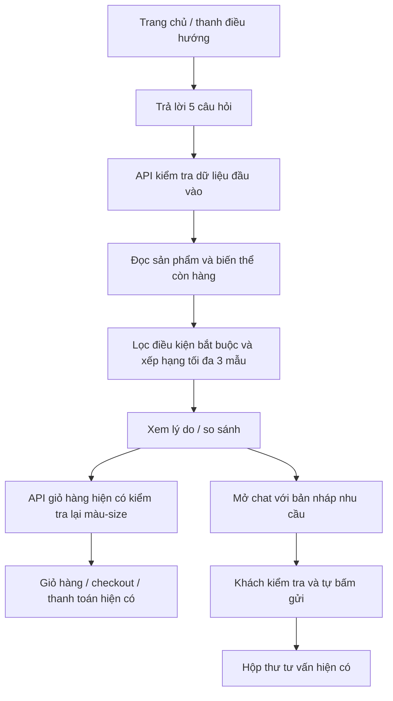

# Tìm giày phù hợp

Bản đầu triển khai ngày 08/11/2026. Khách trả lời năm câu hỏi, nhận tối đa ba gợi ý có lý do, so sánh rồi thêm đúng màu/size vào giỏ hoặc nhờ nhân viên tư vấn.

## Cách sử dụng

1. Bấm **Tìm giày phù hợp** trên thanh điều hướng hoặc **Tìm đôi giày của bạn** trong phần giới thiệu ở trang chủ. Đường dẫn: `/shoe-finder`.
2. Chọn mục đích sử dụng, phong cách, ngân sách tối đa cho một đôi, size EU và màu ưu tiên. Màu/phong cách có thể để không ưu tiên.
3. Xem gợi ý và lý do. Bỏ/chọn dấu so sánh, bấm **So sánh … đôi đã chọn** khi chọn ít nhất hai đôi.
4. **Thêm vào giỏ** thêm một đôi theo chính màu/size trên thẻ. Khách chưa đăng nhập được đưa đến đăng nhập rồi quay lại bộ lựa chọn.
5. **Nhờ tư vấn** mở khung **Nhân viên tư vấn** với bản nháp gồm nhu cầu, ngân sách, màu/size và đôi đang cân nhắc. Khách tự bấm **Gửi tin**. Nếu đã soạn tin khác, nội dung cũ được giữ; khách chọn **Thêm vào tin đang soạn** để ghép nội dung.

Khách chưa đăng nhập vẫn làm câu hỏi, xem và so sánh được. Nhân viên dùng kho/tác vụ tư vấn của mình; admin dùng hộp thư quản trị. Hai vai trò này không được mở một cuộc chat dưới danh nghĩa khách bằng chức năng mới.

## Admin chuẩn bị dữ liệu

Vào **Quản trị → Sản phẩm → Chỉnh sửa → Gợi ý chọn giày**:

- Chọn các **mục đích sử dụng** phù hợp với sản phẩm thực tế.
- Chọn các **phong cách** nếu cửa hàng đã xác định được.
- Lưu như chỉnh sửa thông tin sản phẩm thông thường. Không cần phân bổ lại tồn kho sản phẩm cũ chỉ để thêm nhãn.

Nhãn là tùy chọn; sản phẩm cũ vẫn dùng được mà không seed hoặc chuyển đổi dữ liệu. Nếu đã chọn danh sách mục đích, hệ thống chỉ gợi ý sản phẩm cho các mục đích đó. Bỏ hết mục đích sẽ quay lại cách chọn theo danh mục:

| Nhu cầu | Danh mục dùng khi chưa gắn mục đích |
|---|---|
| Đi chơi, hằng ngày | Sneaker, Sandal, Giày thể thao |
| Đi học | Sneaker, Giày thể thao |
| Đi làm | Giày da, Sneaker, Giày cao gót |
| Đi dạo | Sneaker, Giày thể thao, Giày chạy bộ |
| Chạy bộ | Giày chạy bộ |
| Tập luyện | Giày thể thao |
| Dự tiệc, sự kiện | Giày da, Giày cao gót |

Với cách chọn theo danh mục, lý do hiển thị rõ **Gợi ý theo danh mục…**. Hệ thống không tự suy đoán giày êm, phù hợp bệnh lý, độ rộng bàn chân hay độ vừa từ tên/ảnh sản phẩm.

## Quy tắc gợi ý

- Chỉ lấy sản phẩm đang bán, chưa ẩn/lưu trữ và còn tồn kho.
- Size và màu phải thuộc **cùng một dòng biến thể có số lượng lớn hơn 0**. Không ghép size của màu khác. Sản phẩm dùng kho chung cũ chỉ xét các size được khai báo.
- Nếu khách chọn màu, phải khớp màu đó; không phân biệt hoa/thường. Nếu không ưu tiên màu, chọn màu còn nhiều hàng nhất trong size đã yêu cầu; trường hợp bằng nhau có thứ tự ổn định.
- Ngân sách áp dụng trên giá bán một đôi sau giảm giá sản phẩm theo công thức tiền VND dùng chung. Chưa trừ voucher và chưa cộng vận chuyển.
- Mục đích, size, màu chỉ định và ngân sách là điều kiện bắt buộc. Phong cách là ưu tiên xếp hạng: khớp nhãn phong cách trước, mục đích được admin gắn trước, rồi giá tăng dần; cuối cùng theo mã sản phẩm để kết quả ổn định. Chỉ nêu lý do phong cách khi sản phẩm thực sự có nhãn khớp.
- Mỗi sản phẩm xuất hiện một lần, tối đa ba sản phẩm. Không đủ hàng thì trả ít hơn; không có thì hiện trạng thái rỗng và cho điều chỉnh hoặc hỏi nhân viên. Không tự nâng ngân sách hoặc đổi size.
- Gợi ý không giữ kho. Backend giỏ hàng và checkout tiếp tục kiểm tra lại hàng, giá và nội dung xác nhận tại thời điểm thao tác. Lỗi hết hàng sau lúc gợi ý được hiển thị để khách chọn lại.
- Khi MongoDB chưa kết nối, chức năng báo chưa sẵn sàng; không dùng sản phẩm mẫu để khẳng định có hàng.

## Luồng chạy và phạm vi ảnh hưởng

| Tệp chính | Vai trò |
|---|---|
| `shared/shoeFinder.js` | Danh sách lựa chọn, xác thực, lọc/xếp hạng và tạo lý do |
| `backend/controllers/shoeFinderController.js` | Đọc MongoDB bằng cursor; chỉ giữ ba kết quả trong bộ nhớ |
| `backend/routes/productRoutes.js` | Hai API công khai đặt trước route `/:id` |
| `backend/models/productModel.js` | Nhãn `recommendation.purposes` và `recommendation.styles`, không bắt buộc |
| `backend/controllers/productController.js` | Lưu nhãn qua quyền admin và cơ chế cập nhật sản phẩm hiện có |
| `frontend/src/components/AdminProducts.jsx` | Form nhập nhãn, không gửi lại nhãn khi chưa thay đổi |
| `frontend/src/pages/ShoeFinder.jsx` | Bộ câu hỏi, kết quả, so sánh, thêm giỏ và yêu cầu tư vấn |
| `frontend/src/utils/shoeFinder.js` | Khôi phục lựa chọn từ URL và chuẩn bị bản nháp tư vấn |
| `frontend/src/components/ChatWidget.jsx` | Nhận nhu cầu của đúng phiên khách và mở chat |
| `frontend/src/components/ChatThread.jsx` | Điền/ghép bản nháp có xác nhận, giữ thao tác gửi thủ công |

API mới: `GET /api/products/recommendation-options` trả size/màu có hàng; `POST /api/products/recommendations` nhận `{ purpose, style, maxPrice, size, color }` và trả lựa chọn cùng danh sách `items`. Hai API chỉ đọc dữ liệu. Câu trả lời được lưu trong URL của trang để quay lại sau đăng nhập; không ghi hồ sơ sở thích vào tài khoản và không dùng dịch vụ AI ngoài.

Use case mới là **Tìm giày theo nhu cầu** và **So sánh gợi ý**. **Thêm giỏ hàng** và **Nhắn tin tư vấn** được tái sử dụng. Không thêm trạng thái đơn, không thay công thức giá, voucher, thanh toán VNPAY, hủy hoặc hoàn hàng. Cập nhật backend, frontend và `shared` cùng nhau; không cần sửa `.env`.

## Kiểm tra

- `npm test`: **434** ca backend đạt, gồm **11** ca mới về đầu vào, biến thể, ngân sách sau giảm, nhãn, dữ liệu công khai và HTTP.
- `npm run test:frontend`: **241** ca Node và **21** luồng ngoại tuyến đạt, gồm câu hỏi thật, phản hồi về trễ, đổi phiên, giỏ hàng, nhãn admin và bản nháp chat.
- `npm run build`: đạt.
- `node frontend/tests/browser/shoe-finder.browser.cjs`: kiểm tra Chrome trên bản build ở **1440×1000** và **390×844**, dùng API giả lập; kiểm tra câu hỏi, ba gợi ý, so sánh, payload giỏ hàng, giữ bản nháp, tự bấm gửi và tràn ngang trên điện thoại. Ảnh và báo cáo nằm tại `frontend/tests/.artifacts/shoe-finder/` và được Git bỏ qua.

Đây là kiểm tra tự động với model/API giả lập, chưa phải kiểm tra tích hợp MongoDB thật cho chức năng mới. Không tạo/sửa hàng, giỏ, hội thoại, đơn hay thanh toán trong dữ liệu cửa hàng trong quá trình kiểm tra. Bản này chưa có hồ sơ bàn chân, bảng quy đổi size riêng từng hãng hoặc học từ lịch sử mua; cần dữ liệu thực tế trước khi triển khai những phần đó.
